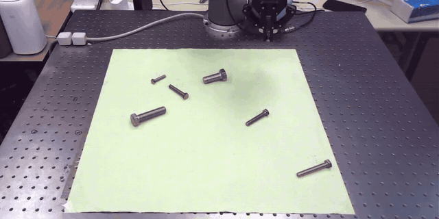
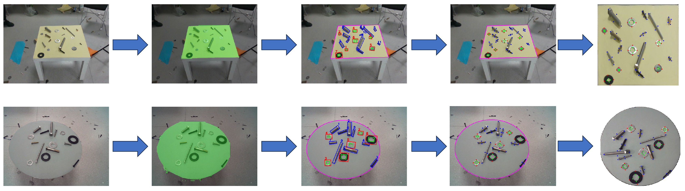

# Industry_detect

[](https://doi.org/10.1016/j.measurement.2026.123888)
[](https://doi.org/10.1016/j.measurement.2026.123888)

## A low-cost visual pre-sorting method validated under controlled conditions

## Real-robot demonstration



## Method

Reflective metallic surfaces can produce depth holes and unreliable boundary depth. The framework uses **RGB-derived oriented bounding box (OBB) keypoints** and a **tabletop metric reference** to estimate fastener dimensions, reducing reliance on depth at metal edges.



1. **Recover the tabletop metric domain.** For square tabletops, regularize the segmented quadrilateral and estimate a four-corner homography. For circular tabletops, combine the RGB contour with the aligned point cloud to recover the tabletop plane and circle. Known tabletop dimensions establish metric scale.
2. **Detect fasteners and refine washer holes.** Detect bolt and washer OBBs; use a second-stage region-of-interest detector for washer inner holes.
3. **Construct and project keypoints.** Map OBB-derived structural keypoints into the rectified metric tabletop domain.
4. **Estimate dimensions and positions.** Compute bolt length and diameter, washer outer and inner diameters, and tabletop-referenced centers.
5. **Apply hierarchical geometric error correction (HGEC).** Compensate for bolt geometry above the tabletop through diameter, height-related center, length, and additional center corrections in the **D → H → L → C** sequence. The corrected diameter supplies the geometric scale for subsequent corrections. Washers use their own dimension branch without bolt HGEC.

The square-tabletop homography path uses RGB geometry. The circular-tabletop path additionally uses depth for tabletop recovery. Both require an externally supplied tabletop dimension.

## Dataset

### Download

| Resource | Access |
| :--- | :--- |
| Dataset share | **Indust_detect** |
| Baidu Netdisk | [Download the dataset](https://pan.baidu.com/s/1y7ULDZ_ZkiCPOnxc7e2QAQ?pwd=9wq4) |
| Extraction code | **`9wq4`** |

## Citation

```bibtex
@article{liu2026visualpresorting,
  author  = {Liu, Qianxi and Cui, Junfeng and Pan, Yitao},
  title   = {A low-cost visual pre-sorting method validated under controlled conditions},
  journal = {Measurement},
  year    = {2026},
  doi     = {10.1016/j.measurement.2026.123888}
}
```

## License

The original documentation and demonstration media in this repository are available under the [Creative Commons Attribution-NonCommercial 4.0 International license (CC BY-NC 4.0)](LICENSE) to the extent the project authors hold the rights. You may copy, share, and adapt these materials for noncommercial purposes with attribution. Commercial use requires separate permission from the rights holder.

The externally hosted dataset follows the terms provided by its maintainer. The journal article, figures reproduced from the manuscript, and third-party materials follow their respective rights holders' terms.
