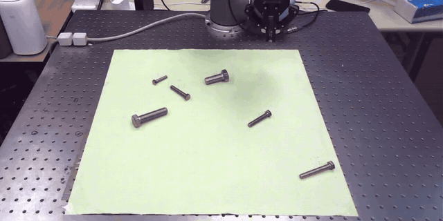

# Experimental Protocol

This page accompanies [*A low-cost visual pre-sorting method validated under controlled conditions*](https://doi.org/10.1016/j.measurement.2026.123888) and the [project overview](../README.md).

## Evaluation protocol

The quantitative evaluation uses 29 independent RGB-D scenes held out from detector training. The 17 square-tabletop scenes and 12 circular-tabletop scenes contain 324 bolts and 240 washers in total. The Astra Pro Plus captures the RGB and depth images at 640 × 480.

A digital caliper provides reference dimensions, and a steel ruler provides tabletop coordinates. One operator takes three readings per quantity and uses the mean as the reference.

- **GT OBB** uses manually annotated oriented bounding boxes to evaluate the geometric measurement stage.
- **Valid Predicted OBB subset** uses matched detections that yield valid measurements to evaluate the effect of predicted box geometry.
- **End-to-end Predicted OBB full set** uses the full ground-truth inventory so that misses and invalid outputs are included in the denominator.

See Sections 3.2.3 and 3.2.4 of the paper for the dataset and evaluation definitions.

## Real-robot protocol

*Full-sequence preview at 3× playback speed; the original-speed video is linked below.*

**[Watch the real-robot grasping demo](../assets/real_robot_grasping_demo.mp4)** · [Download the original MP4](https://github.com/lqx943576099/Industry_detect/raw/refs/heads/main/assets/real_robot_grasping_demo.mp4) (63.3 MB)

An Astra Pro Plus camera observes the UR5 workbench from a fixed, oblique angle. The measurement interface estimates bolt dimensions and positions, and the robot operation interface uses the source and destination information specified for the pick-and-place task. The destinations, source–target correspondences, and transfer order are specified before execution. Side-view phone footage documents the trial.

Section 3.8 of the paper describes the grasping and dimensional evaluation and the separate interface integration trial.
